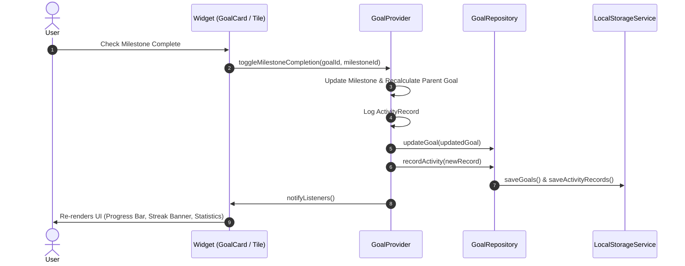

# Software Architecture Documentation

**Project:** Personal Goal Achievement Tracker  
**Student Roll Number:** `24PA1A05I4`  
**Pattern:** Clean Architecture (MVVM with Repository & Service Boundaries)  

---

## 1. Architectural Philosophy

The application employs **Decoupled Layered Architecture (MVVM)** to ensure high testability, maintainability, and clean separation between business logic and UI presentation.

```
┌────────────────────────────────────────────────────────┐
│                   Presentation Layer                   │
│       Views (Dashboard, Goal Details, Analytics)       │
│           Widgets (Cards, Tiles, Charts, Chips)        │
└───────────────────────────▲────────────────────────────┘
                            │ (ChangeNotifier / Watch)
┌───────────────────────────┴────────────────────────────┐
│                    ViewModel Layer                     │
│          GoalProvider      •      SettingsProvider     │
└───────────────────────────▲────────────────────────────┘
                            │ (Domain Calls)
┌───────────────────────────┴────────────────────────────┐
│                    Repository Layer                    │
│                     GoalRepository                     │
└───────────────────────────▲────────────────────────────┘
                            │ (Data Contracts)
┌───────────────────────────┴────────────────────────────┐
│                     Service Layer                      │
│       LocalStorageService   •   NotificationService    │
└───────────────────────────▲────────────────────────────┘
                            │
┌───────────────────────────┴────────────────────────────┐
│                     Storage Engine                     │
│          SharedPreferences / Atomic JSON Store         │
└────────────────────────────────────────────────────────┘
```

---

## 2. Layer Responsibilities

### 2.1 Model Layer (`lib/models/`)
- Contains pure, immutable domain entities: `Goal`, `Milestone`, `ActivityRecord`.
- Business rules and mathematical formulas are encapsulated inside domain models (e.g. `progressPercentage`, `effectiveIsCompleted`, `isOverdue`).
- Independent of Flutter UI widgets, ensuring high-speed headless testing.

### 2.2 Service Layer (`lib/services/`)
- `IStorageService`: Defines interface contracts for atomic JSON persistence, export, and import.
- `LocalStorageService`: Implements local persistence using device storage with serialization safety and error handling.
- `INotificationService`: Contract for deadline reminders and alert dispatching with honest platform fallbacks.

### 2.3 Repository Layer (`lib/repositories/`)
- `GoalRepository`: Coordinates data operations between storage services and domain entities.
- Cleans up orphan daily focus references upon goal deletion.
- Provides sample demonstration data seeding.

### 2.4 ViewModel / State Layer (`lib/viewmodels/`)
- `GoalProvider`: The primary `ChangeNotifier` driving reactive UI updates across all tabs.
  - Manages active goals, filter states (search query, category, status, sort order).
  - Maintains Daily Focus IDs and activity history.
  - Exposes derived getters for analytics and live overview cards.
- `SettingsProvider`: Manages theme preferences (Light, Dark, System) and reminder settings.

### 2.5 Presentation Layer (`lib/views/` & `lib/widgets/`)
- `MainNavigationShell`: Uses `IndexedStack` to maintain scroll positions and tab state.
- Widgets are modular and reusable (`GoalCard`, `MilestoneTile`, `CustomBadge`, `EmptyState`, `ConfirmDialog`).
- Adheres to Material 3 styling tokens, consistent spacing (16px grid), and accessible touch targets.

---

## 3. Data Flow Diagram



---

## 4. Key Design Decisions

1. **Deterministic Streak Calculation:**
   - Instead of incrementing an arbitrary counter on button taps, the streak is calculated from the set of unique calendar dates present in `ActivityRecord`.
   - Dates are normalized to midnight local time (`DateTime(y, m, d)`), eliminating timezone drift and duplicate multi-click fraud.

2. **Safe Mathematical Progress Calculations:**
   - Division by zero is avoided through conditional guards. Zero-milestone goals yield `0.0%` without NaN errors.
   - Goals with zero milestones are never marked completed automatically.

3. **Offline Resilience & Zero Network Dependency:**
   - The app runs 100% offline. No external servers or API keys are required.
