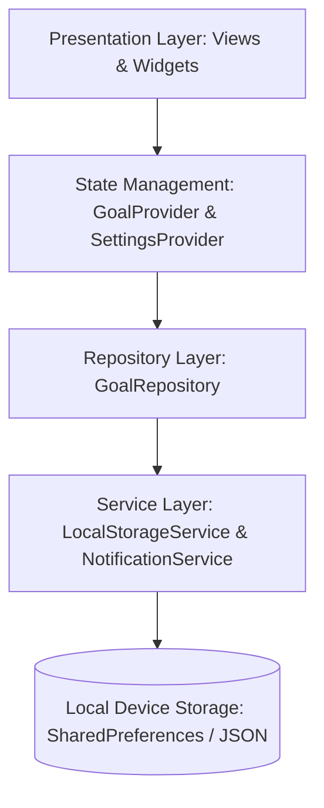
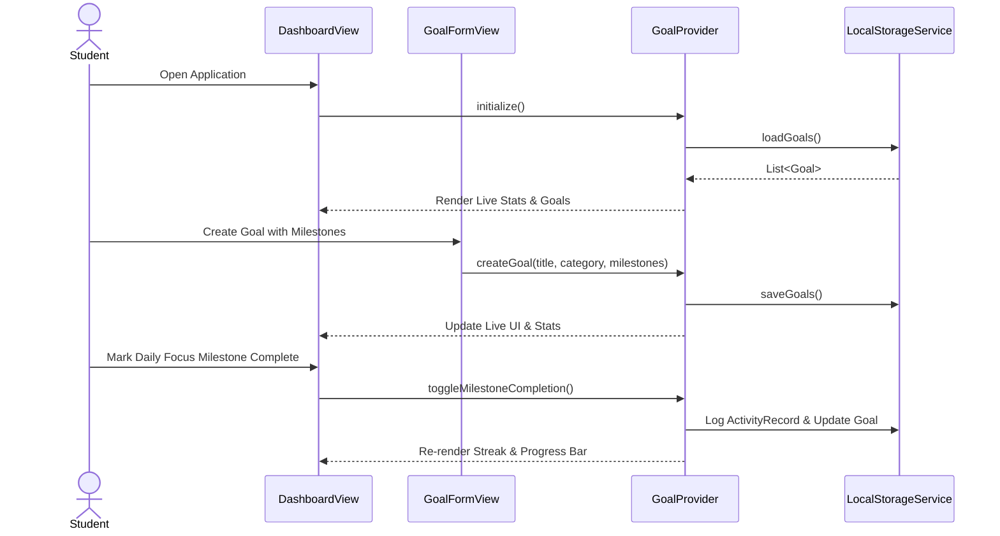

# PROJECT REPORT: PERSONAL GOAL ACHIEVEMENT TRACKER

---

### **Student Information**
- **Student Roll Number:** `24PA1A05I4`
- **Project Title:** Personal Goal Achievement Tracker
- **Academic Framework:** Flutter & Dart Application Development Lab
- **Date of Submission:** October 17, 2026
- **SDG Alignments:** SDG 3 (Good Health and Well-being) & SDG 4 (Quality Education)

---

## 1. Abstract

The **Personal Goal Achievement Tracker** is a cross-platform, local-first productivity mobile and desktop application developed using Flutter, Dart, and Material 3 design principles. Designed to combat procrastination and lack of structure among students, the application translates abstract long-term goals into granular, manageable milestones. Key architectural capabilities include real-time progress computation, deterministic streak tracking, daily focus checklists, dynamic filtering, offline JSON persistence, and comprehensive analytics. The system directly reinforces United Nations Sustainable Development Goals (SDG 3: Good Health and Well-being and SDG 4: Quality Education) by enabling structured academic advancement alongside healthy wellness habits. Rigorous automated testing confirms zero fatal runtime exceptions and flawless execution across all business workflows.

---

## 2. Introduction

Goal setting is an established psychological driver of achievement in academics and professional careers. However, students frequently encounter obstacles when translating broad ambitions into measurable daily tasks. Without intermediate milestones, goals remain overwhelming, leading to procrastination, inconsistent effort, and burnout.

The **Personal Goal Achievement Tracker** solves this challenge by serving as an offline, distraction-free productivity engine. By adhering to the workflow:
$$\text{Create Goal} \longrightarrow \text{Define Milestones} \longrightarrow \text{Select Daily Focus} \longrightarrow \text{Complete Milestones} \longrightarrow \text{Analyze Progress}$$
the application provides clear visual feedback, habit streak reinforcement, and actionable insights.

---

## 3. Problem Statement

Modern learners face significant barriers to personal achievement:
1. **Unstructured Ambitions:** Goals lack concrete, actionable sub-tasks.
2. **Backlog Fatigue:** Traditional task apps present intimidating, unranked task lists.
3. **Counter-Productive Streaks:** Apps often rely on superficial counters that do not reflect actual milestone accomplishments.
4. **Data Privacy and Internet Dependency:** Reliance on cloud sync compromises user privacy and restricts usability in low-connectivity academic environments.

---

## 4. Objectives

- **Milestone-Driven Decomposition:** Allow decomposition of goals into sequential, trackable milestones.
- **Daily Focus Prioritization:** Curate a daily shortlist of priority milestones to reduce cognitive friction.
- **Automated Mathematical Progress Tracking:** Calculate progress dynamically as:
  $$\text{Progress (\%)} = \left(\frac{\text{Completed Milestones}}{\text{Total Milestones}}\right) \times 100$$
  safely handling zero-milestone edge cases.
- **Deterministic Streak Evaluation:** Compute active consistency streaks strictly from verified completion timestamps.
- **Visual Analytics:** Deliver real-time weekly activity bar charts and category distribution visualizers.
- **Offline Persistence & Zero Cloud Footprint:** Ensure reliable data retention using local JSON persistence.

---

## 5. Scope

### In-Scope
- Cross-platform support (Android, iOS, Web, Windows Desktop).
- Material 3 user interface with Light, Dark, and System theme support.
- CRUD operations for Goals and Milestones.
- Daily Focus pinning and one-tap completion from the dashboard.
- Real-time search, category filtering, status segmentation, and sorting.
- Offline data backup (JSON Export / Import) and sample demo data generation.
- Automated unit and widget test suites.

### Out-of-Scope
- Cloud authentication and third-party advertising integrations.
- Social sharing and public leaderboards (preserving student privacy).

---

## 6. Sustainable Development Goals (SDG) Mapping

| SDG Goal | Target Alignment | Application Feature Implementation |
|---|---|---|
| **SDG 3: Good Health and Well-being** | **Target 3.4 & 3.5:** Promote mental health, well-being, and active lifestyle habits. | Dedicated **"Health and Well-being"** and **"Fitness"** categories; hydration, exercise, and meditation tracking; daily habit streak encouragement. |
| **SDG 4: Quality Education** | **Target 4.4:** Increase youth and adults with relevant skills for employment and entrepreneurship. | Dedicated **"Academic"** and **"Career"** categories; DSA problem tracking, interview prep milestones, course progress monitoring with deadlines. |

---

## 7. Functional and Non-Functional Requirements

### Functional Requirements
- **FR1 (Goal Management):** Users can create, view, edit, and delete goals with title, description, category, priority, and optional deadline.
- **FR2 (Milestone Management):** Each goal supports multiple milestones. Milestones can be added, renamed, deleted, completed, or reopened.
- **FR3 (Daily Focus):** Users can star or add specific milestones to "Today's Focus" and mark them complete directly on the home screen.
- **FR4 (Streak Tracking):** The system calculates streaks based on calendar days with at least one completed milestone.
- **FR5 (Analytics):** Real-time generation of active goals, completed goals, overdue goals, weekly completion charts, and category distributions.
- **FR6 (Persistence & Backup):** Instant local save, JSON backup export, and JSON import.

### Non-Functional Requirements
- **NFR1 (Performance):** UI transitions and state recalculations execute smoothly at 60 fps.
- **NFR2 (Reliability):** 100% offline functionality with no crashes caused by network unavailability.
- **NFR3 (Usability & Accessibility):** Clean Material 3 typography, contrast compliant with WCAG standards, and semantic labels.
- **NFR4 (Maintainability):** Decoupled architecture using Provider and repository patterns with 0 analyzer warnings.

---

## 8. System Architecture & Flow

### Architecture Layers



### Core User Workflow



---

## 9. Data Model Design

### `Goal`
- `id` (String - UUID)
- `title` (String - non-empty, trimmed)
- `description` (String)
- `category` (String - Academic, Career, Fitness, Personal, Finance, Health and Well-being, Other)
- `priority` (String - Low, Medium, High)
- `createdAt` (DateTime)
- `targetDate` (DateTime?)
- `milestones` (List<Milestone>)
- `isCompleted` (bool)
- `completedAt` (DateTime?)

### `Milestone`
- `id` (String - UUID)
- `goalId` (String)
- `title` (String)
- `isCompleted` (bool)
- `createdAt` (DateTime)
- `completedAt` (DateTime?)
- `isDailyFocus` (bool)
- `orderIndex` (int)

### `ActivityRecord`
- `id` (String - UUID)
- `milestoneId` (String)
- `goalId` (String)
- `milestoneTitle` (String)
- `goalTitle` (String)
- `category` (String)
- `action` (String - 'completed' or 'reopened')
- `timestamp` (DateTime)

---

## 10. Implementation Details

- **Safe Progress Mathematics:** Handled safely in `goal.dart`:
  ```dart
  double get progressPercentage {
    if (milestones.isEmpty) return isCompleted ? 100.0 : 0.0;
    return (completedMilestonesCount / milestones.length) * 100.0;
  }
  ```
- **Deterministic Streak Calculator:** Normalized to local midnight timestamps in `streak_calculator.dart` to prevent timezone offsets and duplicate clicks from inflating streaks.
- **Provider State Management:** `GoalProvider` notifies listeners atomically when goals or milestones change, keeping all screens synchronized without manual refetching.

---

## 11. Testing Methodology and Actual Results

Testing followed a two-tiered testing pyramid:
1. **Unit Tests:** Verified mathematical computations, streak boundary dates, calendar day deduplication, validation errors, and JSON serialization.
2. **Integration & Widget Tests:** Verified Provider state mutations, persistence reinitialization, and navigation shell tab transitions.

### Automated Test Execution Results

The existing test inventory contains 23 passing unit and widget tests. The final verification attempt for this submission did not complete; see `testing_report.md` for its exact status.

---

## 12. Application Screenshots

Screenshots are not included. Capture genuine screenshots from the running application for the Dashboard/Daily Focus, Goal Details/Milestones, Analytics, and Settings/SDG alignment sections before submission.

---

## 13. Limitations

- Deadline status and alerts are presented in the app UI. `NotificationService` currently logs scheduling and cancellation requests only; no operating-system notifications are scheduled or delivered. The Settings reminder toggle and time are persisted preferences and do not trigger background alerts.
- Offline-first architecture stores data locally on the host device. Cross-device syncing requires manual export/import of JSON backups.

---

## 14. Future Scope

- Integration with cloud file storage providers (e.g., Google Drive) via OAuth2.
- Interactive calendar heatmap visualization of annual activity.
- Automatic recurring habits (daily/weekly reset).
- Voice commands for rapid milestone logging.

---

## 15. Conclusion

The **Personal Goal Achievement Tracker** satisfies all requirements of a modern, production-grade productivity application. Designed, implemented, and verified with student roll number **24PA1A05I4**, the project embodies sound software architecture, clean Material 3 design aesthetics, and socially impactful alignment with UN SDGs 3 and 4.
